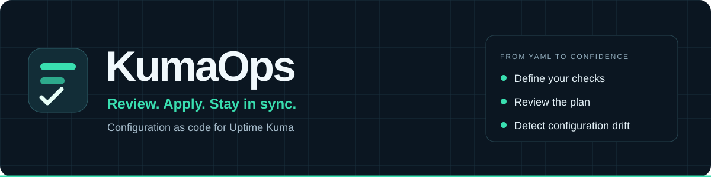
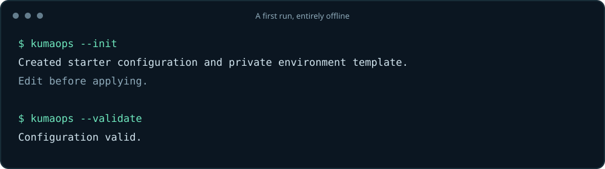

<p align="center">
  
</p>

<p align="center">
  <a href="https://github.com/mormied22/kumaops/actions/workflows/ci.yml"></a>
  <a href="https://github.com/mormied22/kumaops/releases/latest"></a>
  <a href="LICENSE"></a>
  <a href="pyproject.toml"></a>
  <a href="https://github.com/mormied22/kumaops/discussions"></a>
</p>

<p align="center">
  <strong>Monitoring configuration you can review, repeat and check in CI.</strong><br />
  Define checks in YAML. Preview changes. Detect drift. Keep secrets out of reports.
</p>

<p align="center">
  <a href="#your-first-deployment">Quick start</a> ·
  <a href="docs/README.md">Documentation</a> ·
  <a href="https://github.com/mormied22/kumaops/releases/latest">Downloads</a> ·
  <a href="https://github.com/mormied22/kumaops/discussions">Ask a question</a> ·
  <a href="CONTRIBUTING.md">Contribute</a>
</p>

---

KumaOps brings configuration as code to **Uptime Kuma v2**: HTTP, TCP and ping checks,
monitor groups, Discord integrations and recurring maintenance. Use an additive plan
for deployment and a read-only check to catch drift in automation.

| Review before deploying | Keep repeat runs predictable | Make automation useful |
| --- | --- | --- |
| Inspect additions and conflicting fields | Reuse matching resources without duplicates | Redacted JSON and explicit drift exit codes |

> **Verified target:** Kuma 2.5.9 with client 2.9.0. Discord provider behavior is
> tested with a local receiver; real-channel delivery remains an opt-in check.
> [Full verification matrix](docs/VALIDATION.md).

## Why use it?

- **Start quickly:** generate a working starter configuration with `--init`.
- **See changes first:** `--plan` lists additions and conflicting fields.
- **Check drift in CI:** `--check` returns a distinct exit code when work is needed.
- **Automate without exposing secrets:** versioned JSON output contains resource
  keys and field names, never configuration values or webhook payloads.
- **Tune checks:** configure retries, retry intervals, HTTP timeouts, GET/HEAD,
  accepted status codes and certificate-expiry notifications.
- **Use private infrastructure:** verified TLS by default, with custom CA bundles
  and explicit 2FA support.

This release is additive. It creates missing resources and maintenance assignments;
existing setting conflicts block apply. Automatic updates and deletion are reserved
for a future ownership-aware reconciliation model.

## Install

Clone or extract this repository and open its root directory. Use a clean virtual
environment so other Kuma client packages do not share the same import name.

```sh
python -m venv .venv
# Linux/macOS
. .venv/bin/activate
# Windows PowerShell instead: .\.venv\Scripts\Activate.ps1
python -m pip install -r requirements.txt
python -m pip install --no-deps .
```

## Your first deployment

<p></p>

```sh
kumaops --init
```

This creates `config.yaml` and `.env` beside it, refusing to overwrite either file.
Edit the example URL in the config and set `KUMA_URL` in `.env`. Supply your Kuma
username/password in that local file, through environment variables, or through
hidden terminal input. Keep real environment files private.

```yaml
version: 1
namespace: my-lab
monitors:
  website:
    type: http
    url: https://example.com
    interval: 60
    maxretries: 2
    retryInterval: 20
    timeout: 10
    method: GET
    accepted_statuscodes: ["200-299"]
```

```sh
kumaops --validate
kumaops --env-file .env --plan
kumaops --env-file .env --apply
kumaops --env-file .env --check
```

A synchronized configuration returns exit code `0` from `--check`. Missing
resources or conflicting settings return `3`. Apply performs its displayed plan
immediately and verifies writes; it does not ask for another confirmation.
New monitors may send real notifications as soon as they start checking.

**2FA:** add `--two-factor` to connected commands to enter a code through hidden
input. Each command logs in separately: wait for a fresh unused code between runs.
Kuma rejects replayed codes even within their validity period. Unattended jobs can
inject a fresh `KUMA_TOTP_CODE`; no authenticator seed is stored by this application.

## Automation

```sh
kumaops --env-file .env --check --non-interactive --format json
```

```json
{"schema_version": 1, "command": "check", "status": "changes", "actions": [{"operation": "create", "kind": "monitor", "key": "website"}], "message": null, "applied": null}
```

JSON is emitted once and never includes raw desired/current values. Conflict
records identify fields such as `interval` or `discordWebhookUrl`, so teams can
review the reason for a block without exporting secrets. JSON mode is always
non-interactive. [CLI and exit-code reference](docs/CLI.md)

Use `--ca-bundle ca.pem` for an internal certificate authority and `--timeout 30`
for a slower management connection. These do not disable certificate verification.
Plain HTTP requires explicit `--allow-http` on a trusted test network or tunnel.

## Examples and documentation

- [One-monitor example](examples/minimal.yaml)
- [Groups, Discord and weekly maintenance](examples/config.yaml)
- [Tuned HTTP checks](examples/http.yaml)
- [Configuration reference](docs/CONFIGURATION.md)
- [Safety and recovery](docs/SAFETY.md)
- [CLI and JSON contract](docs/CLI.md)
- [Integration tests and DST behavior](docs/INTEGRATION.md)
- [Validation record](docs/VALIDATION.md)
- [Architecture](docs/ARCHITECTURE.md) · [Roadmap](ROADMAP.md)

## Safety boundaries

Reserve a namespace for KumaOps and keep a Kuma backup before applying. Matching
uses reserved names and configured fields, not durable proof of resource ownership.
Renaming a key or namespace creates another identity; removing YAML entries leaves
existing server resources alone. Run only one writer per instance/namespace,
including manual UI changes and other management tools.

Applies from the same configuration directory use a local lock. It is not a
distributed lock and does not exclude other hosts or directories. A crashed process
may leave a stale lock; inspect the process before removing it. Failed or uncertain
writes are never retried automatically, and there is no rollback. Re-plan after
inspecting the server. [Detailed safety model](docs/SAFETY.md)

Maintenance defaults to inactive. Verify scope before activation. Use explicit IANA
timezones and same-day windows; **03:00–03:30 Europe/London** avoids the UK clock-change
hour. DST edge behavior is characterized for the pinned upstream version.

## Development

```sh
python -m pip install -r requirements-dev.txt
python -m pip install --no-deps -e .
python -m pytest -q
python -m ruff check .
python -m ruff format --check src tests tools
```

Default tests are offline. Hosted CI is configured for Linux/Windows and Python
3.11–3.13, plus a pinned Kuma integration job. Actual Discord credentials are never
needed for public CI. See [contribution guidelines](CONTRIBUTING.md),
[security policy](SECURITY.md), and [release guide](docs/PUBLISHING.md).

KumaOps uses the community [uptime-kuma-api2 client](https://github.com/pbarone/uptime-kuma-api2).
It is unofficial and not affiliated with Uptime Kuma. The internal management API
can change; untested upstream versions are not guaranteed compatible.

[MIT License](LICENSE) · [Changelog](CHANGELOG.md)

## Join the project

- **Trying it for the first time?** Follow the quick start and share sanitized setup
  feedback in [Discussions](https://github.com/mormied22/kumaops/discussions).
- **Need help?** See [support and troubleshooting](SUPPORT.md).
- **Found a reproducible bug?** Use the [bug report form](https://github.com/mormied22/kumaops/issues/new?template=bug.yml).
- **Want to contribute?** Start with [contribution opportunities](docs/CONTRIBUTOR_GUIDE.md)
  and the [roadmap](ROADMAP.md). Small documentation and test improvements are welcome.
- **Want to follow development?** Watch releases and star the repository if it is useful to you.

Please read the [community guidelines](CODE_OF_CONDUCT.md). Never share webhook URLs,
authentication codes, environment files or private infrastructure logs in public.
